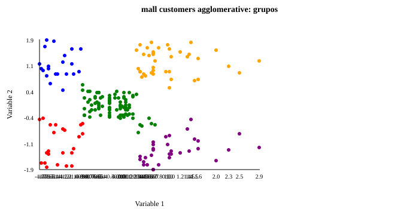

# Agglomerative Clustering

**Dataset:** [Mall Customers](https://www.kaggle.com/datasets/vjchoudhary7/customer-segmentation-tutorial-in-python)  
**Task:** Clustering

Merges nearby customers into five groups using Ward linkage.

## Workflow

The program loads the dataset, selects useful features, prepares the inputs, fits the KAFE model, and prints several predictions or assignments. Supervised examples split training and test data before fitting a scaler. Clustering examples use unlabeled observations.

```kafe
--8<-- "docs/ejemplos/machine-mall-customers-agglomerative.kf"
```

[Download the KAFE program](../machine-mall-customers-agglomerative.kf) · [All MACHINE methods](../machine-kaggle.md)

## Visual check

{ .example-chart }

The chart complements the printed predictions; use the metrics for evaluation.
