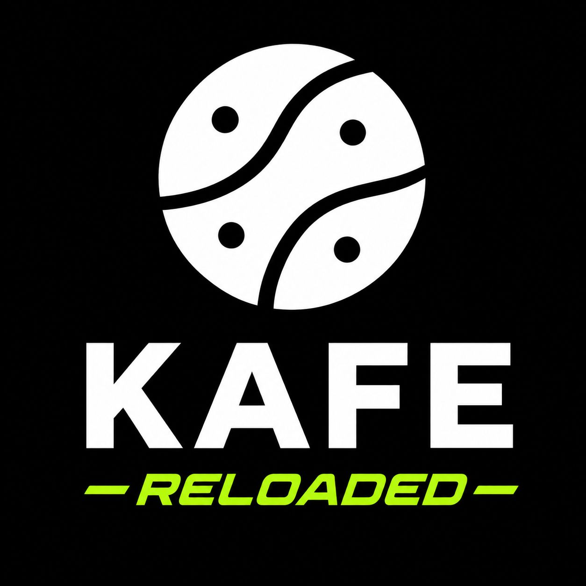

# KAFE { .kafe-sr-only }

<div class="kafe-hero" markdown>



<p class="kafe-tagline">Learn programming, Machine Learning and neural networks, step by step.</p>

<p class="kafe-subtitle">KAFE is a programming language made for learning. You write a little code, you understand all of it, and you see how a computer learns from data.</p>

[Start here :material-arrow-right:](aprende/index.md){ .md-button .md-button--primary }
[Install KAFE](getting-started/installation.md){ .md-button }

</div>

---

## What can you do with KAFE?

<div class="grid cards" markdown>

-   :material-baby-face-outline:{ .lg .middle } **Start from zero**

    ---

    You don't need to know how to program. Every idea is explained with everyday examples before you see any code.

-   :material-function-variant:{ .lg .middle } **Think in functions**

    ---

    Create your own functions with `drip` and combine them like LEGO pieces.

-   :material-table:{ .lg .middle } **Work with data**

    ---

    Read tables and CSV files with PARDOS and draw charts with PLOT.

-   :material-chart-scatter-plot:{ .lg .middle } **Machine Learning**

    ---

    Train models that predict and group data with the MACHINE library.

-   :material-brain:{ .lg .middle } **Neural networks**

    ---

    Build neurons, layers and complete networks with GESHA and watch them learn.

-   :material-translate:{ .lg .middle } **In English and Spanish**

    ---

    All the documentation can be read in both languages. Use the language button at the top.

</div>

---

## A quick look

This is a KAFE program that computes the average of some grades:

```kafe
-- A list of grades and their average
List[FLOAT] grades = [4.5, 3.8, 5.0];
FLOAT total = 0.0;
for (n in grades):
    total = total + n;
;
show("Average:");
show(total / len(grades));
```

When you run it, KAFE shows:

```text
Average:
4.433333333333334
```

!!! tip "What happened here?"
    1. We stored three grades in a **list**.
    2. We walked through the list with `for`, adding each grade.
    3. We divided the total by the number of grades (`len`) and printed the result with `show`.

---

## Where do I start?

| If you… | Start at |
|---|---|
| Have never programmed | [Learn: What is programming?](aprende/programar.md) |
| Already program in another language | [Tutorial: your first program](getting-started/first-program.md) |
| Want to do Machine Learning | [MACHINE library](libraries/machine.md) and its [examples](ejemplos/machine-kaggle.md) |
| Want to build neural networks | [GESHA library](libraries/gesha.md) and its [examples](ejemplos/gesha-examples.md) |
| Want to see how it works inside | [Advanced: formal grammar](specification/ebnf-grammar.md) |

---

## About the project

- **Version**: v2.0.0
- **License**: GPL-3.0
- **Repository**: [GitHub](https://github.com/joshmessi10/KAFE-Reloaded)
- **Authors**: Josh Sebastián López Murcia, Franklin Julián González Pérez, Karen Yireth Castañeda
- **Co-authors**: Andrés Felipe Sindicue, Luis Felipe Valencia, Emanuel Felipe Molina
- **Advisor**: Joaquín Sánchez — Universidad Sergio Arboleda
