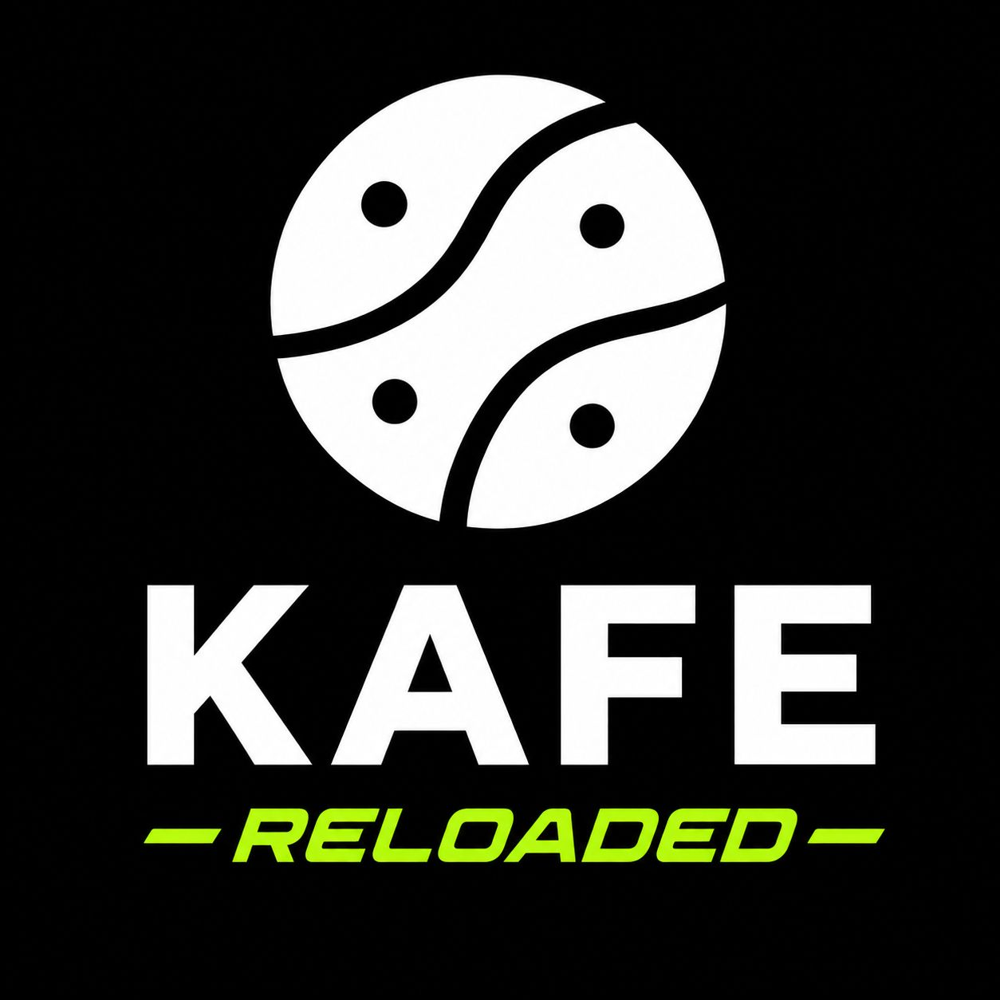

# KAFE { .kafe-sr-only }

<div class="kafe-hero" markdown>



<p class="kafe-tagline">Aprende a programar, Machine Learning y redes neuronales, paso a paso.</p>

<p class="kafe-subtitle">KAFE es un lenguaje de programación hecho para aprender. Escribes poco código, lo entiendes todo y ves cómo una computadora aprende de los datos.</p>

[Empieza aquí :material-arrow-right:](aprende/index.md){ .md-button .md-button--primary }
[Instalar KAFE](getting-started/installation.md){ .md-button }

</div>

---

## ¿Qué puedes hacer con KAFE?

<div class="grid cards" markdown>

-   :material-baby-face-outline:{ .lg .middle } **Empezar desde cero**

    ---

    No necesitas saber programar. Cada idea se explica con ejemplos de la vida diaria antes de ver el código.

-   :material-function-variant:{ .lg .middle } **Pensar con funciones**

    ---

    Crea tus propias funciones con `drip` y combínalas como piezas de LEGO.

-   :material-table:{ .lg .middle } **Trabajar con datos**

    ---

    Lee tablas y archivos CSV con PARDOS y dibuja gráficas con PLOT.

-   :material-chart-scatter-plot:{ .lg .middle } **Machine Learning**

    ---

    Entrena modelos que predicen y agrupan datos con la librería MACHINE.

-   :material-brain:{ .lg .middle } **Redes neuronales**

    ---

    Construye neuronas, capas y redes completas con GESHA y mira cómo aprenden.

-   :material-translate:{ .lg .middle } **En español y en inglés**

    ---

    Toda la documentación se puede leer en los dos idiomas. Usa el botón de idioma arriba.

</div>

---

## Un vistazo rápido

Así se ve un programa de KAFE que calcula el promedio de unas notas:

```kafe
-- Una lista de notas y su promedio
List[FLOAT] notas = [4.5, 3.8, 5.0];
FLOAT suma = 0.0;
for (n in notas):
    suma = suma + n;
;
show("Promedio:");
show(suma / len(notas));
```

Cuando lo ejecutas, KAFE muestra:

```text
Promedio:
4.433333333333334
```

!!! tip "¿Qué pasó aquí?"
    1. Guardamos tres notas en una **lista**.
    2. Recorrimos la lista con `for` y fuimos sumando cada nota.
    3. Dividimos la suma entre la cantidad de notas (`len`) y mostramos el resultado con `show`.

---

## ¿Por dónde empiezo?

| Si tú… | Empieza en |
|---|---|
| Nunca has programado | [Aprende: ¿Qué es programar?](aprende/programar.md) |
| Ya programas en otro lenguaje | [Tutorial: tu primer programa](getting-started/first-program.md) |
| Quieres hacer Machine Learning | [Librería MACHINE](libraries/machine.md) y sus [ejemplos](ejemplos/machine-kaggle.md) |
| Quieres crear redes neuronales | [Librería GESHA](libraries/gesha.md) y sus [ejemplos](ejemplos/gesha-examples.md) |
| Quieres ver cómo funciona por dentro | [Avanzado: gramática formal](specification/ebnf-grammar.md) |

---

## Sobre el proyecto

- **Versión**: v2.0.0
- **Licencia**: GPL-3.0
- **Repositorio**: [GitHub](https://github.com/joshmessi10/KAFE-Reloaded)
- **Autores**: Josh Sebastián López Murcia, Franklin Julián González Pérez, Karen Yireth Castañeda
- **Coautores**: Andrés Felipe Sindicue, Luis Felipe Valencia, Emanuel Felipe Molina
- **Director**: Joaquín Sánchez — Universidad Sergio Arboleda
