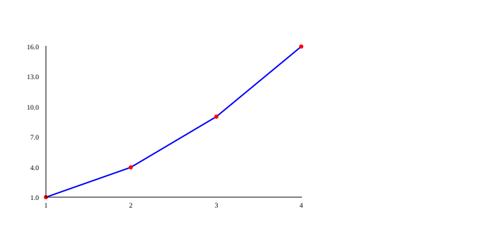

# PLOT: charts

The **PLOT** library turns lists of numbers into **pictures**: lines, points, bars and pies. A chart lets you see at a glance what would take a long time to understand by reading a long list of numbers.

**What is it for?** To see how something changes over time (a line), compare groups (bars), show the parts of a whole (a pie) or look at your data before training a machine learning model.

## Before you start: import the library

A library is an extra **toolbox**. To use it, first bring it into your program with `import`, then use each tool with `plot.` in front:

```kafe
--8<-- "tests/DocsExamples/plot/figure.kf"
```

**Result:** this program doesn't print anything on the screen. Instead, it saves a picture in the file `figure.svg`, which looks like this:

{ .example-chart }

!!! warning "Common mistake: forgetting the `import`"
    If you use `plot.` without writing `import plot;`, KAFE doesn't know which box you mean:

    ```kafe
    --8<-- "tests/DocsExamples/plot/no-import.error.kf"
    ```

    ```text
    --8<-- "tests/DocsExamples/plot/no-import.error.stderr.expec"
    ```

## Where does my chart appear? { #output }

PLOT **doesn't open any window**. It writes the picture into an **SVG file** (an image format described with text that any web browser can open). The file:

- is saved **in the same folder as your `.kf` program**;
- has **the same name as your program**, with the `.svg` extension: if your program is `notes.kf`, the picture is `notes.svg`;
- is **replaced** every time you draw again in the same program. If you draw two charts, only the last one is kept.

To see it, open that file with your browser (double-click it or drag it into a tab).

!!! tip "The examples clean up after themselves"
    The examples on these pages end with `files.delete(...)` (from the [FILES](files.md) library) so they don't leave pictures lying around in the test folder. In your program, remove those lines to keep the picture. The images you see on the page are what you get without them.

## How it works inside { #inside }

PLOT is written in Python in two files: `src/lib/KafePLOT/functions.py` (the functions you call) and `src/lib/KafePLOT/utils.py` (what PLOT remembers and how it saves the file). It works like a painter who first writes down the instructions and paints everything at once at the end:

1. **Write down the settings.** `title`, `xlabel`, `color` and the other style functions don't draw anything. They only store a value in a variable in `utils.py`, like notes on a whiteboard: `chart_title`, `line_color`, `point_size`…
2. **Store each series.** Each `graph(x, y)` adds to a list called `_accumulated_series` a package with the two lists of numbers and the colors that were written down at that moment. A **series** is a group of points that belong together, like one line.
3. **Work out where each point goes.** `render()` finds the smallest and the largest value of all the series. With them it turns each number into a position in **pixels** (the tiny dots on the screen): the smallest lands on one edge and the largest on the other. Then it joins the points with lines (`<line>`) and draws circles (`<circle>`).
4. **Write the file and clean the whiteboard.** The whole picture is a text that starts with `<svg>` and ends with `</svg>`. PLOT saves it in the `.svg` file and puts every setting back the way it was at the start.

<figure class="kafe-fig">
--8<-- "docs/assets/illustrations/plot-inside.svg"
<figcaption>Step by step: the settings are written down, `graph` stores the series, `render` turns each number into pixels and the SVG text is saved in a file.</figcaption>
</figure>

`bar` and `pie` are more direct: they don't wait for `render`. They work out their picture and save the file right away.

??? info "For the curious 🤓"
    To place a value $x$ between the minimum value $x_{min}$ and the maximum $x_{max}$, `render` uses a **rule of three**:

    $$
    \text{pixel}_x = p + \frac{x - x_{min}}{x_{max} - x_{min}} \cdot (\text{width} - 2p)
    $$

    where $p$ is the margin around the picture. The $y$ axis works the same way, but flipped, because in an image pixel 0 is at the **top**. In a pie, each slice takes an angle of $\frac{\text{value}}{\text{total}} \cdot 360°$, and PLOT uses `math.cos` and `math.sin` from the [MATH](math.md) library to find the edges of each slice.

## Library map

| Page | What you will find |
|---|---|
| [Lines and points](plot/lines.md) | How to make a chart step by step: [`figure`](plot/lines.md#figure), [`graph`](plot/lines.md#graph) and [`render`](plot/lines.md#render). |
| [Titles, axes and colors](plot/style.md) | How to style it: [`title`](plot/style.md#title), [`xlabel`](plot/style.md#xlabel), [`ylabel`](plot/style.md#ylabel), [`grid`](plot/style.md#grid), [`color`](plot/style.md#color), [`pointColor`](plot/style.md#pointcolor), [`pointSize`](plot/style.md#pointsize) and [`legend`](plot/style.md#legend). |
| [Bars and pies](plot/bars-pies.md) | Charts to compare groups: [`bar`](plot/bars-pies.md#bar), [`barValues`](plot/bars-pies.md#barvalues) and [`pie`](plot/bars-pies.md#pie). |

To see PLOT inside a machine learning project, look at the [K-Means example](../ejemplos/machine/kmeans.md).

## What did you learn?

- To use PLOT you write `import plot;` and then `plot.name(...)`.
- PLOT doesn't open windows: it saves an `.svg` file with the same name as your program.
- Inside, PLOT writes down the settings, collects the series and at the end turns each number into pixels.

[Start: lines and points :material-arrow-right:](plot/lines.md){ .md-button .md-button--primary }
