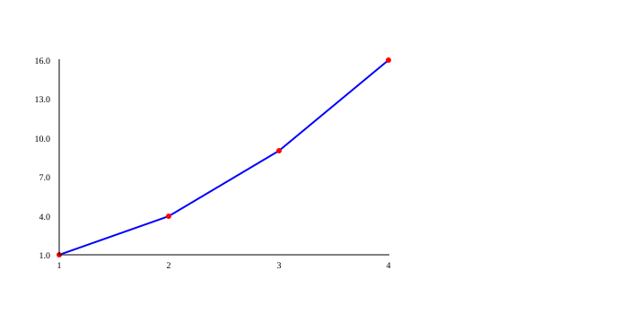

# PLOT: gráficos

La librería **PLOT** convierte listas de números en **dibujos**: líneas, puntos, barras y pasteles. Un gráfico te deja ver de un vistazo lo que costaría entender leyendo una lista larga de números.

**¿Para qué sirve?** Para ver cómo cambia algo con el tiempo (una línea), comparar grupos (barras), mostrar partes de un todo (un pastel) o mirar los datos antes de entrenar un modelo de aprendizaje automático.

## Antes de empezar: importar la librería

Una librería es una **caja de herramientas** extra. Para usarla, primero la traes a tu programa con `import`, y luego usas cada herramienta con `plot.` delante:

```kafe
--8<-- "tests/DocsExamples/plot/figure.kf"
```

**Resultado:** este programa no escribe nada en la pantalla. En su lugar, guarda un dibujo en el archivo `figure.svg`, que se ve así:

{ .example-chart }

!!! warning "Error común: olvidar el `import`"
    Si usas `plot.` sin haber escrito `import plot;`, KAFE no sabe de qué caja hablas:

    ```kafe
    --8<-- "tests/DocsExamples/plot/no-import.error.kf"
    ```

    ```text
    --8<-- "tests/DocsExamples/plot/no-import.error.stderr.expec"
    ```

## ¿Dónde aparece mi gráfico? { #output }

PLOT **no abre ninguna ventana**. Escribe el dibujo en un **archivo SVG** (un formato de imagen que se describe con texto y se puede abrir en cualquier navegador). El archivo:

- se guarda **en la misma carpeta que tu programa `.kf`**;
- se llama **igual que tu programa**, con la extensión `.svg`: si tu programa es `notas.kf`, el dibujo es `notas.svg`;
- se **reemplaza** cada vez que dibujas otra vez en el mismo programa. Si dibujas dos gráficos, solo queda el último.

Para verlo, abre ese archivo con tu navegador (doble clic o arrástralo a una pestaña).

!!! tip "Los ejemplos se limpian solos"
    Los ejemplos de estas páginas terminan con `files.delete(...)` (de la librería [FILES](files.md)) para no dejar dibujos sueltos en la carpeta de pruebas. En tu programa, quita esas líneas para quedarte con el dibujo. Las imágenes que ves en la página son lo que obtienes sin ellas.

## Cómo funciona por dentro { #inside }

PLOT está escrita en Python en dos archivos: `src/lib/KafePLOT/functions.py` (las funciones que llamas) y `src/lib/KafePLOT/utils.py` (lo que PLOT recuerda y cómo guarda el archivo). Funciona como un pintor que primero apunta las instrucciones y al final pinta todo de una vez:

1. **Apuntar los ajustes.** `title`, `xlabel`, `color` y las demás funciones de estilo no dibujan nada. Solo guardan un valor en una variable de `utils.py`, como notas en una pizarra: `chart_title`, `line_color`, `point_size`…
2. **Guardar cada serie.** Cada `graph(x, y)` agrega a una lista llamada `_accumulated_series` un paquete con las dos listas de números y los colores que estaban apuntados en ese momento. Una **serie** es un grupo de puntos que van juntos, como una línea.
3. **Calcular dónde va cada punto.** `render()` busca el valor más pequeño y el más grande de todas las series. Con ellos convierte cada número en una posición en **píxeles** (los puntitos de la pantalla): el más pequeño queda en un borde y el más grande en el otro. Después une los puntos con líneas (`<line>`) y dibuja círculos (`<circle>`).
4. **Escribir el archivo y borrar la pizarra.** Todo el dibujo es un texto que empieza con `<svg>` y termina con `</svg>`. PLOT lo guarda en el archivo `.svg` y vuelve a poner todos los ajustes como al principio.

<figure class="kafe-fig">
--8<-- "docs/assets/illustrations/plot-inside.svg"
<figcaption>Paso a paso: los ajustes se apuntan, `graph` guarda la serie, `render` convierte cada número en píxeles y el texto SVG se guarda en un archivo.</figcaption>
</figure>

`bar` y `pie` son más directos: no esperan a `render`. Calculan su dibujo y guardan el archivo en el mismo momento.

??? info "Para curiosos 🤓"
    Para colocar un valor $x$ entre el valor mínimo $x_{min}$ y el máximo $x_{max}$, `render` usa una **regla de tres**:

    $$
    \text{píxel}_x = p + \frac{x - x_{min}}{x_{max} - x_{min}} \cdot (\text{ancho} - 2p)
    $$

    donde $p$ es el margen alrededor del dibujo. En el eje $y$ se hace lo mismo, pero dado vuelta, porque en una imagen el píxel 0 está **arriba**. En un pastel, cada parte ocupa un ángulo de $\frac{\text{valor}}{\text{total}} \cdot 360°$, y PLOT usa `math.cos` y `math.sin` de la librería [MATH](math.md) para encontrar los bordes de cada trozo.

## Mapa de la librería

| Página | Qué encuentras |
|---|---|
| [Líneas y puntos](plot/lines.md) | Cómo se hace un gráfico paso a paso: [`figure`](plot/lines.md#figure), [`graph`](plot/lines.md#graph) y [`render`](plot/lines.md#render). |
| [Títulos, ejes y colores](plot/style.md) | Cómo darle estilo: [`title`](plot/style.md#title), [`xlabel`](plot/style.md#xlabel), [`ylabel`](plot/style.md#ylabel), [`grid`](plot/style.md#grid), [`color`](plot/style.md#color), [`pointColor`](plot/style.md#pointcolor), [`pointSize`](plot/style.md#pointsize) y [`legend`](plot/style.md#legend). |
| [Barras y pasteles](plot/bars-pies.md) | Gráficos para comparar grupos: [`bar`](plot/bars-pies.md#bar), [`barValues`](plot/bars-pies.md#barvalues) y [`pie`](plot/bars-pies.md#pie). |

Para ver PLOT dentro de un proyecto de aprendizaje automático, mira el [ejemplo de K-Means](../ejemplos/machine/kmeans.md).

## ¿Qué aprendiste?

- Para usar PLOT escribes `import plot;` y luego `plot.nombre(...)`.
- PLOT no abre ventanas: guarda un archivo `.svg` con el mismo nombre que tu programa.
- Por dentro, PLOT apunta los ajustes, junta las series y al final convierte cada número en píxeles.

[Empezar: líneas y puntos :material-arrow-right:](plot/lines.md){ .md-button .md-button--primary }
