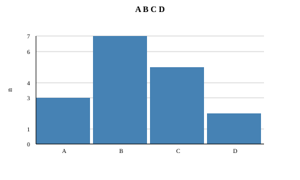
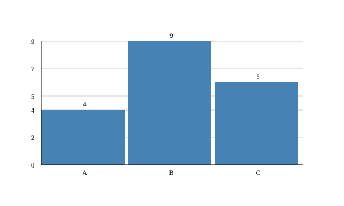
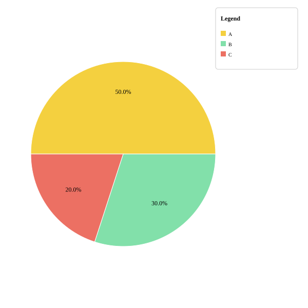

# PLOT: bars and pies

Lines show how something changes. But sometimes you want to **compare groups**: which fruit does your class like best? There are two charts for that:

- A **bar** chart is like stacking blocks: each group gets its own tower, and the tallest one has the most.
- A **pie** chart is like sharing a pizza: each group gets a slice, and the biggest slice has the most **of the total**.

Unlike lines, `bar` and `pie` **don't need `render()`**: they save the `.svg` file as soon as you call them. Write the settings (like `title`) before calling them.

!!! tip "The examples clean up after themselves"
    The examples end with `files.delete(...)` so they don't leave pictures in the test folder. Remove those lines in your program to keep the picture.

### `plot.bar(labels, values)` { #bar }

**What it does:** Draws one **bar** for each group. The height of each bar depends on its value, and its name appears below it. The tallest bar reaches the top, and the others are measured against it.

**When to use it:** To compare amounts of different groups: votes, goals per player, books per month.

| Parameter | Type | What it means |
|---|---|---|
| `labels` | `List[STR]` | The name of each group. |
| `values` | `List[INT] | List[FLOAT]` | The value of each group, in the same order. |

**Returns:** `VOID` (nothing). The picture is saved right away.

**Example:**

```kafe
--8<-- "tests/DocsExamples/plot/bar.kf"
```

**Result:** the file `bar.svg`:

{ .example-chart }

!!! note "Watch out"
    - `bar` uses `title`, `ylabel` and `barValues`. It **doesn't use** `xlabel`, `grid` or `color`: the bars are always blue and the gray guide lines always appear.
    - The guide-line numbers are rounded to whole numbers, so sometimes they don't go up one by one (here: 0, 1, 3, 4, 6, 7).
    - `labels` and `values` must have the same size. If every value is `0`, the picture only shows the message `All values are zero`.

### `plot.barValues(on)` { #barvalues }

**What it does:** Turns on (`True`) or off (`False`) the **number above each bar**. It starts off.

**When to use it:** When you want the exact value to be readable without guessing it from the guide lines.

| Parameter | Type | What it means |
|---|---|---|
| `on` | `BOOL` | `True` to show the numbers, `False` to hide them. |

**Returns:** `VOID` (nothing).

**Example:**

```kafe
--8<-- "tests/DocsExamples/plot/bar-values.kf"
```

**Result:** the file `bar-values.svg`:

{ .example-chart }

`barValues` only works with `bar`; in the other charts it does nothing.

### `plot.pie(labels, values)` { #pie }

**What it does:** Draws a **pie**: a circle split into slices. Each slice is as big as the part its value represents of the total, and it shows its **percentage** (how many out of 100).

**When to use it:** To show how a whole is shared: the time in your day, your class's favorite colors.

| Parameter | Type | What it means |
|---|---|---|
| `labels` | `List[STR]` | The name of each slice. |
| `values` | `List[INT] | List[FLOAT]` | The value of each slice, in the same order. |

**Returns:** `VOID` (nothing). The picture is saved right away.

**Example:**

```kafe
--8<-- "tests/DocsExamples/plot/pie.kf"
```

**Result:** the file `pie.svg`:

{ .example-chart }

!!! note "Watch out"
    - In a pie, the slice **names** only appear in the legend. To show it, call `plot.legend(...)` with **any** text before `pie`: the pie doesn't use that text, but the names in `labels` with their colors.
    - `pie` **doesn't show** the title (`title`) or the axis names.
    - The slice colors are fixed and repeat if there are more than 10 groups.

??? warning "Common mistake: a total of zero"
    If every value is `0`, there is nothing to share:

    ```kafe
    --8<-- "tests/DocsExamples/plot/pie-zero.error.kf"
    ```

    ```text
    --8<-- "tests/DocsExamples/plot/pie-zero.error.stderr.expec"
    ```

??? info "For the curious 🤓"
    Each slice takes an angle proportional to its value:

    $$
    \text{angle} = \frac{\text{value}}{\text{total}} \cdot 360°
    $$

    With the values 50, 30 and 20 (total 100), the slices measure 180°, 108° and 72°. PLOT finds the tips of each slice on the edge of the circle with $x = c_x + r\cos\theta$ and $y = c_y + r\sin\theta$, using the functions of the [MATH](../math.md) library.

## Summary { #summary }

| Function | What it does |
|---|---|
| [`plot.bar(labels, values)`](#bar) | Draws and saves a bar chart. |
| [`plot.barValues(on)`](#barvalues) | Shows the number above each bar. |
| [`plot.pie(labels, values)`](#pie) | Draws and saves a pie chart. |

## What did you learn?

- Bars compare amounts; a pie shows the parts of a whole.
- `bar` and `pie` save the picture by themselves, without `render()`.
- In a pie, `legend` turns on the legend with the slice names.

[Next library: NUMK :material-arrow-right:](../numk.md){ .md-button .md-button--primary }
