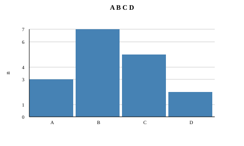
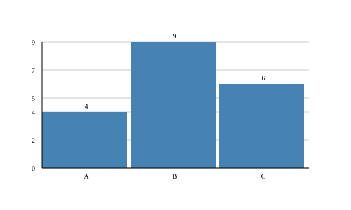
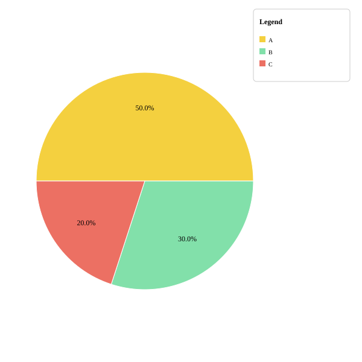

# PLOT: barras y pasteles

Las líneas sirven para ver cómo cambia algo. Pero a veces quieres **comparar grupos**: ¿qué fruta gusta más en tu clase? Para eso hay dos gráficos:

- Un gráfico de **barras** es como apilar bloques: cada grupo tiene su torre, y la más alta es la que tiene más.
- Un gráfico de **pastel** es como repartir una pizza: cada grupo se lleva un trozo, y el trozo más grande es el que tiene más **del total**.

A diferencia de las líneas, `bar` y `pie` **no necesitan `render()`**: guardan el archivo `.svg` en cuanto los llamas. Escribe los ajustes (como `title`) antes de llamarlos.

!!! tip "Los ejemplos se limpian solos"
    Los ejemplos terminan con `files.delete(...)` para no dejar dibujos en la carpeta de pruebas. Quita esas líneas en tu programa para quedarte con el dibujo.

### `plot.bar(labels, values)` { #bar }

**Qué hace:** Dibuja una **barra** por cada grupo. La altura de cada barra depende de su valor, y debajo aparece su nombre. La barra más alta llega hasta arriba, y las demás se miden en comparación con ella.

**Cuándo usarla:** Para comparar cantidades de grupos distintos: votos, goles por jugador, libros por mes.

| Parámetro | Tipo | Qué significa |
|---|---|---|
| `labels` | `List[STR]` | El nombre de cada grupo. |
| `values` | `List[INT] | List[FLOAT]` | El valor de cada grupo, en el mismo orden. |

**Devuelve:** `VOID` (nada). El dibujo se guarda enseguida.

**Ejemplo:**

```kafe
--8<-- "tests/DocsExamples/plot/bar.kf"
```

**Resultado:** el archivo `bar.svg`:

{ .example-chart }

!!! note "Ojo"
    - `bar` usa `title`, `ylabel` y `barValues`. **No usa** `xlabel`, `grid` ni `color`: las barras son siempre azules y las líneas guía grises siempre aparecen.
    - Los números de las líneas guía se redondean a enteros, por eso a veces no van de uno en uno (aquí: 0, 1, 3, 4, 6, 7).
    - `labels` y `values` deben tener el mismo tamaño. Si todos los valores son `0`, el dibujo solo muestra el aviso `All values are zero`.

### `plot.barValues(on)` { #barvalues }

**Qué hace:** Enciende (`True`) o apaga (`False`) el **número encima de cada barra**. Al empezar está apagado.

**Cuándo usarla:** Cuando quieras que se lea el valor exacto sin tener que adivinarlo con las líneas guía.

| Parámetro | Tipo | Qué significa |
|---|---|---|
| `on` | `BOOL` | `True` para mostrar los números, `False` para ocultarlos. |

**Devuelve:** `VOID` (nada).

**Ejemplo:**

```kafe
--8<-- "tests/DocsExamples/plot/bar-values.kf"
```

**Resultado:** el archivo `bar-values.svg`:

{ .example-chart }

`barValues` solo sirve con `bar`; en los demás gráficos no hace nada.

### `plot.pie(labels, values)` { #pie }

**Qué hace:** Dibuja un **pastel**: un círculo repartido en trozos. Cada trozo es tan grande como la parte que su valor representa del total, y lleva escrito su **porcentaje** (cuántos de cada 100).

**Cuándo usarla:** Para mostrar cómo se reparte un todo: el tiempo de tu día, los colores favoritos de tu clase.

| Parámetro | Tipo | Qué significa |
|---|---|---|
| `labels` | `List[STR]` | El nombre de cada trozo. |
| `values` | `List[INT] | List[FLOAT]` | El valor de cada trozo, en el mismo orden. |

**Devuelve:** `VOID` (nada). El dibujo se guarda enseguida.

**Ejemplo:**

```kafe
--8<-- "tests/DocsExamples/plot/pie.kf"
```

**Resultado:** el archivo `pie.svg`:

{ .example-chart }

!!! note "Ojo"
    - En un pastel, los **nombres** de los trozos solo se ven en la leyenda. Para que aparezca, llama a `plot.legend(...)` con **cualquier** texto antes de `pie`: el pastel no usa ese texto, sino los nombres de `labels` con sus colores.
    - `pie` **no muestra** el título (`title`) ni los nombres de los ejes.
    - Los colores de los trozos son fijos y se repiten si hay más de 10 grupos.

??? warning "Error común: un total de cero"
    Si todos los valores son `0`, no hay nada que repartir:

    ```kafe
    --8<-- "tests/DocsExamples/plot/pie-zero.error.kf"
    ```

    ```text
    --8<-- "tests/DocsExamples/plot/pie-zero.error.stderr.expec"
    ```

??? info "Para curiosos 🤓"
    Cada trozo ocupa un ángulo proporcional a su valor:

    $$
    \text{ángulo} = \frac{\text{valor}}{\text{total}} \cdot 360°
    $$

    Con los valores 50, 30 y 20 (total 100), los trozos miden 180°, 108° y 72°. PLOT encuentra las puntas de cada trozo en el borde del círculo con $x = c_x + r\cos\theta$ y $y = c_y + r\sin\theta$, usando las funciones de la librería [MATH](../math.md).

## Resumen { #summary }

| Función | Qué hace |
|---|---|
| [`plot.bar(labels, values)`](#bar) | Dibuja y guarda un gráfico de barras. |
| [`plot.barValues(on)`](#barvalues) | Muestra el número encima de cada barra. |
| [`plot.pie(labels, values)`](#pie) | Dibuja y guarda un gráfico de pastel. |

## ¿Qué aprendiste?

- Las barras comparan cantidades; el pastel muestra partes de un todo.
- `bar` y `pie` guardan el dibujo solos, sin `render()`.
- En un pastel, `legend` enciende la leyenda con los nombres de los trozos.

[Siguiente librería: NUMK :material-arrow-right:](../numk.md){ .md-button .md-button--primary }
