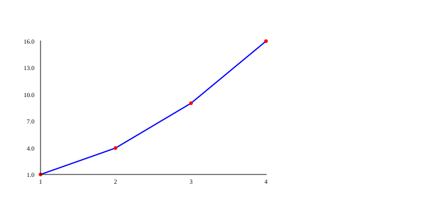
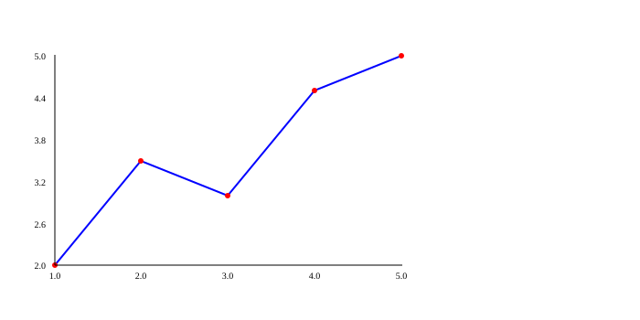
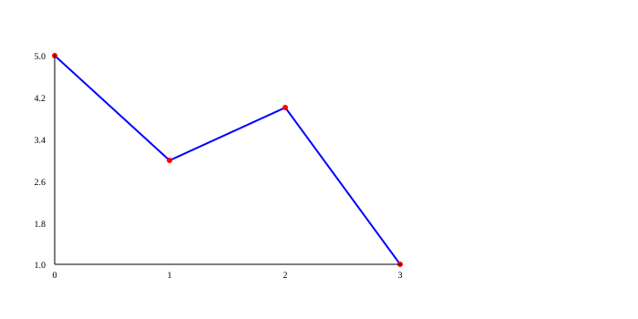
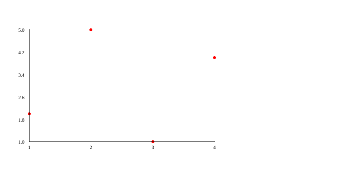
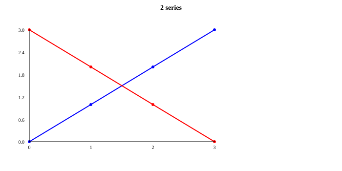

# PLOT: lines and points

A line chart is like a **connect-the-dots** puzzle: each pair of numbers $(x, y)$ is a dot, and the line joins them in order. It shows whether something goes up, goes down or stays the same.

Making a chart in PLOT takes three steps, like painting a picture:

1. `plot.figure()` puts a **new canvas** on the easel.
2. `plot.graph(...)` **paints** a series of points (you can paint several).
3. `plot.render()` **finishes the picture** and saves it in the `.svg` file.

If you haven't yet, read on the [entry page](../plot.md#output) where the picture file appears.

!!! tip "The examples clean up after themselves"
    The examples end with `files.delete(...)` so they don't leave pictures in the test folder. Remove those lines in your program to keep the picture.

### `plot.figure()` { #figure }

**What it does:** Starts a **new** chart. It erases the series and the earlier settings (title, colors, grid…) so you start with a clean canvas.

**When to use it:** Always at the start of each line or point chart, before any style setting.

It takes no parameters.

**Returns:** `VOID` (nothing).

**Example:**

```kafe
--8<-- "tests/DocsExamples/plot/figure.kf"
```

**Result:** the file `figure.svg`:

{ .example-chart }

!!! note "Watch out"
    Because `figure()` puts everything back to the start, write the settings (`title`, `color`…) **after** `figure()`. If you put them before, they are erased.

### `plot.graph(x, y, style)` { #graph }

**What it does:** Adds a **series** of points to the chart. Each position in the lists makes one point: `x[0]` with `y[0]`, `x[1]` with `y[1]`, and so on.

**When to use it:** To see how a value changes: a plant's height day by day or the sales of each month.

| Parameter | Type | What it means |
|---|---|---|
| `x` | `List[INT] | List[FLOAT]` | The horizontal positions. |
| `y` | `List[INT] | List[FLOAT]` | The heights. It must have as many numbers as `x`. |
| `style` | `STR` | Optional. `"line"` (line only), `"point"` (points only) or `"both"` (both, the default). |

**Returns:** `VOID` (nothing).

**Example:**

```kafe
--8<-- "tests/DocsExamples/plot/graph.kf"
```

**Result:** the file `graph.svg`:

{ .example-chart }

By default the line is blue and the points are red. You can change them in [Titles, axes and colors](style.md).

**Other ways to call it:**

- **With a single list**, `plot.graph(y)`: PLOT uses the positions `0, 1, 2…` as `x`.

    ```kafe
    --8<-- "tests/DocsExamples/plot/graph-one-list.kf"
    ```

    { .example-chart }

- **With a list of pairs**, `plot.graph([[x, y], ...], style)`: each little pair `[x, y]` is one point.

    ```kafe
    --8<-- "tests/DocsExamples/plot/graph-pairs.kf"
    ```

    { .example-chart }

!!! note "Watch out: `graph` without `figure` draws right away"
    If you call `graph` **without** calling `figure()` first, PLOT saves the picture at that very moment, without waiting for `render()`. It is a shortcut for quick charts:

    ```kafe
    --8<-- "tests/DocsExamples/plot/graph-quick.kf"
    ```

    After that, a `render()` would give an error, because the chart is already finished.

??? warning "Common mistake: lists of different sizes"
    Every `x` needs its `y`. If one list has extra numbers, KAFE stops:

    ```kafe
    --8<-- "tests/DocsExamples/plot/graph-length.error.kf"
    ```

    ```text
    --8<-- "tests/DocsExamples/plot/graph-length.error.stderr.expec"
    ```

??? warning "Common mistake: a style that doesn't exist"
    Only `"line"`, `"point"` and `"both"` are valid:

    ```kafe
    --8<-- "tests/DocsExamples/plot/graph-style.error.kf"
    ```

    ```text
    --8<-- "tests/DocsExamples/plot/graph-style.error.stderr.expec"
    ```

### `plot.render()` { #render }

**What it does:** **Finishes** the chart: it draws every series you added with `graph`, the axes and the texts, and saves it in the `.svg` file. Then it puts the settings back to the start.

**When to use it:** At the end of each chart you started with `figure()`. If you add several series before `render()`, they all appear in the same picture.

It takes no parameters.

**Returns:** `VOID` (nothing). The picture is in the file.

**Example:** two series in the same chart. Each `color` applies to the series you add **after** it.

```kafe
--8<-- "tests/DocsExamples/plot/render.kf"
```

**Result:** the file `render.svg`:

{ .example-chart }

??? warning "Common mistake: `render` without series"
    `render()` needs at least one `graph(...)` since the last `figure()`:

    ```kafe
    --8<-- "tests/DocsExamples/plot/render-empty.error.kf"
    ```

    ```text
    --8<-- "tests/DocsExamples/plot/render-empty.error.stderr.expec"
    ```

!!! note "Watch out"
    `bar` and `pie` don't use `render()`: they save their picture by themselves. If you call `render()` after one of them, you get the error above.

## Summary { #summary }

| Function | What it does |
|---|---|
| [`plot.figure()`](#figure) | Starts a new chart and erases the settings. |
| [`plot.graph(x, y, style)`](#graph) | Adds a series of points. |
| [`plot.render()`](#render) | Draws everything and saves the `.svg` file. |

## What did you learn?

- A line chart takes three steps: `figure`, `graph` and `render`.
- `graph` accepts two lists, a single list or a list of pairs.
- Several series before `render()` appear in the same picture.

[Next: titles, axes and colors :material-arrow-right:](style.md){ .md-button .md-button--primary }
