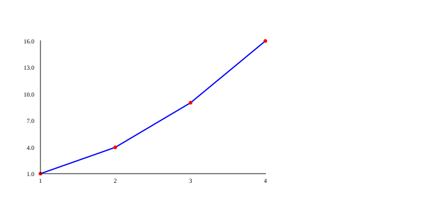
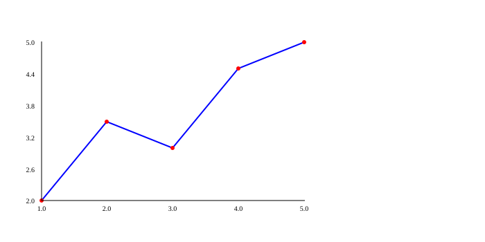
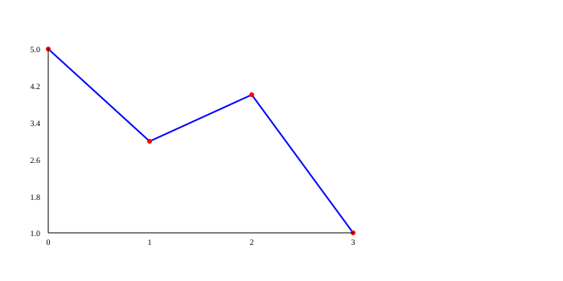
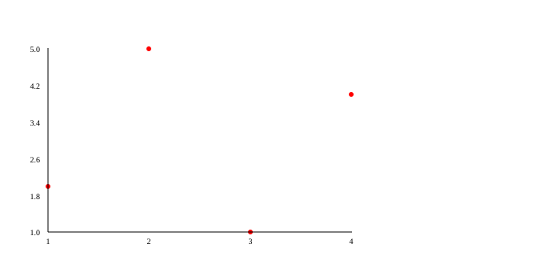
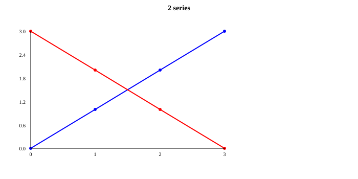

# PLOT: líneas y puntos

Un gráfico de líneas es como **unir los puntos** de un cuaderno de actividades: cada par de números $(x, y)$ es un punto, y la línea los conecta en orden. Sirve para ver si algo sube, baja o se queda igual.

Hacer un gráfico en PLOT tiene tres pasos, como pintar un cuadro:

1. `plot.figure()` pone un **lienzo nuevo** en el caballete.
2. `plot.graph(...)` **pinta** una serie de puntos (puedes pintar varias).
3. `plot.render()` **termina el cuadro** y lo guarda en el archivo `.svg`.

Si todavía no lo has hecho, lee en la [página de entrada](../plot.md#output) dónde aparece el archivo del dibujo.

!!! tip "Los ejemplos se limpian solos"
    Los ejemplos terminan con `files.delete(...)` para no dejar dibujos en la carpeta de pruebas. Quita esas líneas en tu programa para quedarte con el dibujo.

### `plot.figure()` { #figure }

**Qué hace:** Empieza un gráfico **nuevo**. Borra la serie y los ajustes de antes (título, colores, cuadrícula…) para que empieces con un lienzo limpio.

**Cuándo usarla:** Siempre al principio de cada gráfico de líneas o puntos, antes de cualquier ajuste de estilo.

No recibe parámetros.

**Devuelve:** `VOID` (nada).

**Ejemplo:**

```kafe
--8<-- "tests/DocsExamples/plot/figure.kf"
```

**Resultado:** el archivo `figure.svg`:

{ .example-chart }

!!! note "Ojo"
    Como `figure()` lo deja todo como al principio, escribe los ajustes (`title`, `color`…) **después** de `figure()`. Si los pones antes, se borran.

### `plot.graph(x, y, style)` { #graph }

**Qué hace:** Agrega una **serie** de puntos al gráfico. Cada posición de las listas forma un punto: `x[0]` con `y[0]`, `x[1]` con `y[1]`, y así.

**Cuándo usarla:** Para ver cómo cambia un valor: la altura de una planta día a día o las ventas de cada mes.

| Parámetro | Tipo | Qué significa |
|---|---|---|
| `x` | `List[INT] | List[FLOAT]` | Las posiciones horizontales. |
| `y` | `List[INT] | List[FLOAT]` | Las alturas. Debe tener tantos números como `x`. |
| `style` | `STR` | Opcional. `"line"` (solo línea), `"point"` (solo puntos) o `"both"` (las dos cosas, el valor por defecto). |

**Devuelve:** `VOID` (nada).

**Ejemplo:**

```kafe
--8<-- "tests/DocsExamples/plot/graph.kf"
```

**Resultado:** el archivo `graph.svg`:

{ .example-chart }

Por defecto la línea es azul y los puntos son rojos. Puedes cambiarlos en [Títulos, ejes y colores](style.md).

**Otras formas de llamarla:**

- **Con una sola lista**, `plot.graph(y)`: PLOT usa las posiciones `0, 1, 2…` como `x`.

    ```kafe
    --8<-- "tests/DocsExamples/plot/graph-one-list.kf"
    ```

    { .example-chart }

- **Con una lista de parejas**, `plot.graph([[x, y], ...], style)`: cada parejita `[x, y]` es un punto.

    ```kafe
    --8<-- "tests/DocsExamples/plot/graph-pairs.kf"
    ```

    { .example-chart }

!!! note "Ojo: `graph` sin `figure` dibuja enseguida"
    Si llamas a `graph` **sin** haber llamado antes a `figure()`, PLOT guarda el dibujo en ese mismo momento, sin esperar a `render()`. Es un atajo para gráficos rápidos:

    ```kafe
    --8<-- "tests/DocsExamples/plot/graph-quick.kf"
    ```

    Después de eso, un `render()` daría error, porque el gráfico ya se terminó.

??? warning "Error común: listas de distinto tamaño"
    Cada `x` necesita su `y`. Si a una lista le sobran números, KAFE se detiene:

    ```kafe
    --8<-- "tests/DocsExamples/plot/graph-length.error.kf"
    ```

    ```text
    --8<-- "tests/DocsExamples/plot/graph-length.error.stderr.expec"
    ```

??? warning "Error común: un estilo que no existe"
    Solo valen `"line"`, `"point"` y `"both"`:

    ```kafe
    --8<-- "tests/DocsExamples/plot/graph-style.error.kf"
    ```

    ```text
    --8<-- "tests/DocsExamples/plot/graph-style.error.stderr.expec"
    ```

### `plot.render()` { #render }

**Qué hace:** **Termina** el gráfico: dibuja todas las series que agregaste con `graph`, los ejes y los textos, y lo guarda en el archivo `.svg`. Después deja los ajustes como al principio.

**Cuándo usarla:** Al final de cada gráfico que empezaste con `figure()`. Si pones varias series antes de `render()`, salen todas en el mismo dibujo.

No recibe parámetros.

**Devuelve:** `VOID` (nada). El dibujo queda en el archivo.

**Ejemplo:** dos series en el mismo gráfico. Cada `color` vale para las series que agregas **después**.

```kafe
--8<-- "tests/DocsExamples/plot/render.kf"
```

**Resultado:** el archivo `render.svg`:

{ .example-chart }

??? warning "Error común: `render` sin series"
    `render()` necesita al menos un `graph(...)` desde el último `figure()`:

    ```kafe
    --8<-- "tests/DocsExamples/plot/render-empty.error.kf"
    ```

    ```text
    --8<-- "tests/DocsExamples/plot/render-empty.error.stderr.expec"
    ```

!!! note "Ojo"
    `bar` y `pie` no usan `render()`: guardan su dibujo ellas solas. Si llamas a `render()` después de una de ellas, obtendrás el error de arriba.

## Resumen { #summary }

| Función | Qué hace |
|---|---|
| [`plot.figure()`](#figure) | Empieza un gráfico nuevo y borra los ajustes. |
| [`plot.graph(x, y, style)`](#graph) | Agrega una serie de puntos. |
| [`plot.render()`](#render) | Dibuja todo y guarda el archivo `.svg`. |

## ¿Qué aprendiste?

- Un gráfico de líneas se hace en tres pasos: `figure`, `graph` y `render`.
- `graph` acepta dos listas, una sola lista o una lista de parejas.
- Varias series antes de `render()` salen en el mismo dibujo.

[Siguiente: títulos, ejes y colores :material-arrow-right:](style.md){ .md-button .md-button--primary }
