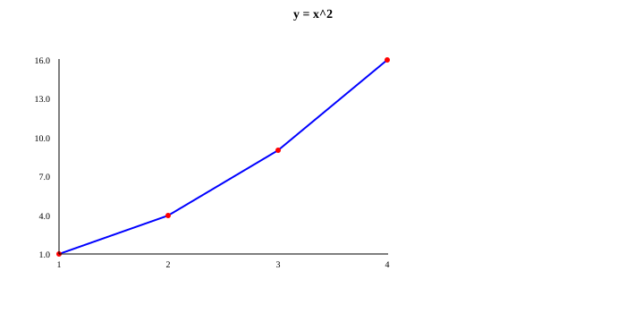
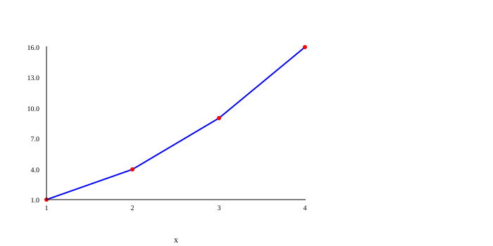
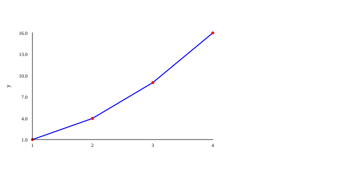
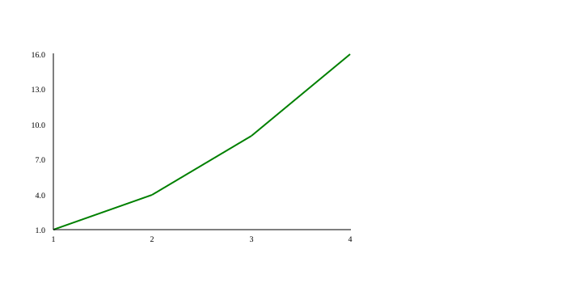
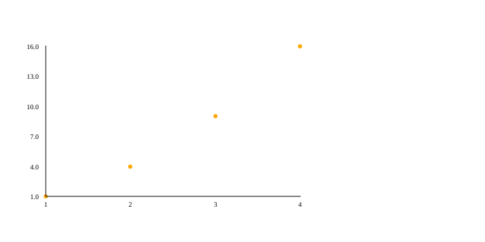
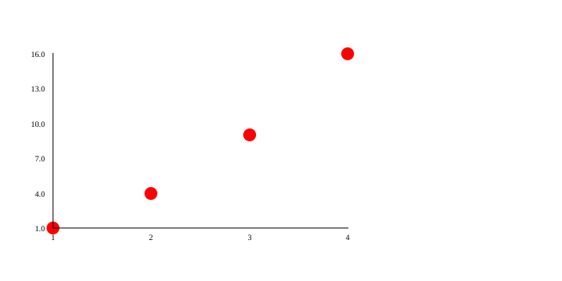
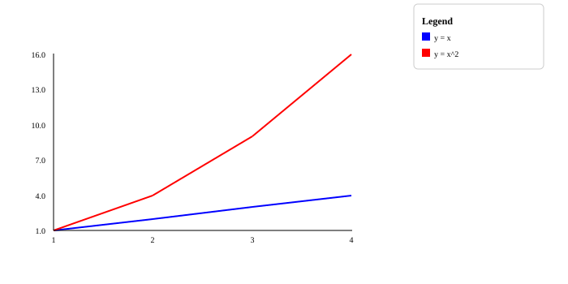

# PLOT: titles, axes and colors

A chart without names is like a map without signs: you see the shapes, but you don't know what they mean. The functions on this page add **signs** (a title and axis names), a **grid** to read values more easily, **colors** and a **legend** that explains each line.

They all work the same way: they **write down a setting** that is used when the chart is drawn. That is why they go **after** `plot.figure()` and **before** `plot.render()`. If you don't know those two yet, start with [Lines and points](lines.md).

!!! tip "The examples clean up after themselves"
    The examples end with `files.delete(...)` so they don't leave pictures in the test folder. Remove those lines in your program to keep the picture.

## Signs: title and axes { #labels }

An **axis** is each of the two rulers of the chart: the **x** axis is the horizontal one (left to right) and the **y** axis is the vertical one (bottom to top).

### `plot.title(text)` { #title }

**What it does:** Puts a **title** above the chart, centered and in bold.

**When to use it:** Whenever someone else will look at your chart: the title says what it is about.

| Parameter | Type | What it means |
|---|---|---|
| `text` | `STR` | The title. |

**Returns:** `VOID` (nothing).

**Example:**

```kafe
--8<-- "tests/DocsExamples/plot/title.kf"
```

**Result:** the file `title.svg`:

{ .example-chart }

### `plot.xlabel(text)` { #xlabel }

**What it does:** Puts a name **below the x axis** (the horizontal one).

**When to use it:** To say what is measured from left to right, for example `"days"`.

| Parameter | Type | What it means |
|---|---|---|
| `text` | `STR` | The name of the x axis. |

**Returns:** `VOID` (nothing).

**Example:**

```kafe
--8<-- "tests/DocsExamples/plot/xlabel.kf"
```

**Result:** the file `xlabel.svg`:

{ .example-chart }

### `plot.ylabel(text)` { #ylabel }

**What it does:** Puts a name **next to the y axis** (the vertical one), turned to read from bottom to top.

**When to use it:** To say what is measured upwards, for example `"height (cm)"`.

| Parameter | Type | What it means |
|---|---|---|
| `text` | `STR` | The name of the y axis. |

**Returns:** `VOID` (nothing).

**Example:**

```kafe
--8<-- "tests/DocsExamples/plot/ylabel.kf"
```

**Result:** the file `ylabel.svg`:

{ .example-chart }

### `plot.grid(on)` { #grid }

**What it does:** Turns on (`True`) or off (`False`) a **grid**: soft gray lines, like the ones in a math notebook, that help you read the values.

**When to use it:** When you want to read more precisely how much each point is worth.

| Parameter | Type | What it means |
|---|---|---|
| `on` | `BOOL` | `True` to show it, `False` to hide it (that is how it starts). |

**Returns:** `VOID` (nothing).

**Example:**

```kafe
--8<-- "tests/DocsExamples/plot/grid.kf"
```

**Result:** the file `grid.svg`:

{ .example-chart }

## Colors and sizes { #colors }

Colors are written with their **English name**, in quotes: `"red"`, `"blue"`, `"green"`, `"orange"`, `"purple"`… Codes like `"#ff8800"` work too. PLOT copies the text as it is into the SVG file, so any color a web browser understands is valid.

Each series remembers the colors that were set **when you called its `graph`**. That way you can change color between one series and the next.

### `plot.color(name)` { #color }

**What it does:** Changes the color of the **line** of the series you add next. It starts as `"blue"`.

**When to use it:** To tell several lines apart in the same chart.

| Parameter | Type | What it means |
|---|---|---|
| `name` | `STR` | The color's English name or a code like `"#ff8800"`. |

**Returns:** `VOID` (nothing).

**Example:**

```kafe
--8<-- "tests/DocsExamples/plot/color.kf"
```

**Result:** the file `color.svg`:

{ .example-chart }

### `plot.pointColor(name)` { #pointcolor }

**What it does:** Changes the color of the **points** (the little circles) of the series you add next. It starts as `"red"`.

**When to use it:** In point charts, or to make the points match their line.

| Parameter | Type | What it means |
|---|---|---|
| `name` | `STR` | The color's English name or a code like `"#ff8800"`. |

**Returns:** `VOID` (nothing).

**Example:**

```kafe
--8<-- "tests/DocsExamples/plot/point-color.kf"
```

**Result:** the file `point-color.svg`:

{ .example-chart }

### `plot.pointSize(size)` { #pointsize }

**What it does:** Changes the **size** of the points. The number is the radius of each little circle, in pixels. It starts as `3`.

**When to use it:** To make the points easier to see when there are few, or smaller when there are many.

| Parameter | Type | What it means |
|---|---|---|
| `size` | `INT` | The radius of each point, in pixels. It must be a whole number. |

**Returns:** `VOID` (nothing).

**Example:**

```kafe
--8<-- "tests/DocsExamples/plot/point-size.kf"
```

**Result:** the file `point-size.svg`:

{ .example-chart }

## Legend { #legend-group }

When there are several lines, a **legend** is the little box that says what each color means, like the one on a map that explains its symbols.

### `plot.legend(text)` { #legend }

**What it does:** Adds a box titled `Legend` to the right of the chart. Each row of the legend is written as `color: text`, and rows are separated with `;`.

**When to use it:** Whenever you draw two or more series in the same chart.

| Parameter | Type | What it means |
|---|---|---|
| `text` | `STR` | The rows, for example `"blue: sales; red: costs"`. |

**Returns:** `VOID` (nothing).

**Example:**

```kafe
--8<-- "tests/DocsExamples/plot/legend.kf"
```

**Result:** the file `legend.svg`:

{ .example-chart }

!!! note "Watch out"
    - PLOT doesn't check that the legend colors match the line colors: you decide what to write.
    - A row without `:` appears as plain text, without a color square.
    - In a **pie** (`pie`) the legend works differently: see [`pie`](bars-pies.md#pie).

## Summary { #summary }

| Function | What it does |
|---|---|
| [`plot.title(text)`](#title) | Title above the chart. |
| [`plot.xlabel(text)`](#xlabel) | Name of the horizontal axis. |
| [`plot.ylabel(text)`](#ylabel) | Name of the vertical axis. |
| [`plot.grid(on)`](#grid) | Turns the grid on or off. |
| [`plot.color(name)`](#color) | Color of the next lines. |
| [`plot.pointColor(name)`](#pointcolor) | Color of the next points. |
| [`plot.pointSize(size)`](#pointsize) | Size of the next points. |
| [`plot.legend(text)`](#legend) | Box that explains each color. |

## What did you learn?

- Style settings go between `figure()` and `render()`.
- Colors are written in English (`"red"`) or as a code (`"#ff8800"`).
- Each series keeps the colors that were set when you called its `graph`.

[Next: bars and pies :material-arrow-right:](bars-pies.md){ .md-button .md-button--primary }
