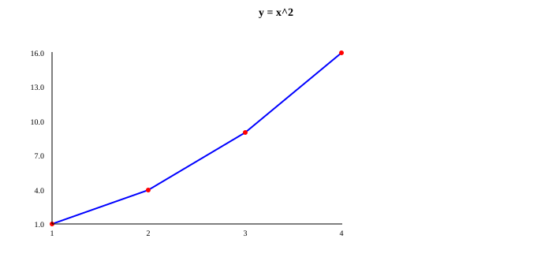
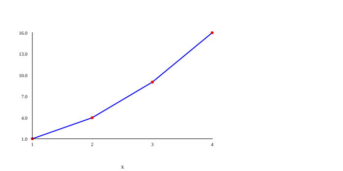
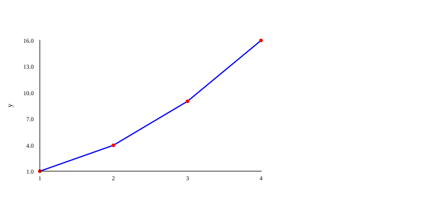
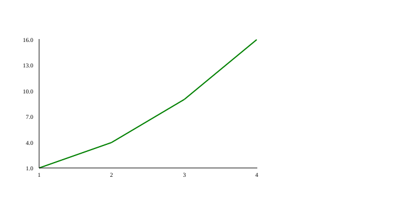
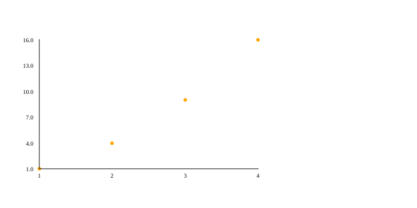
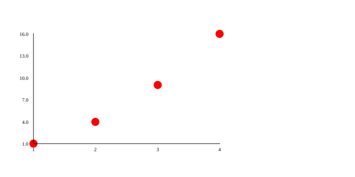
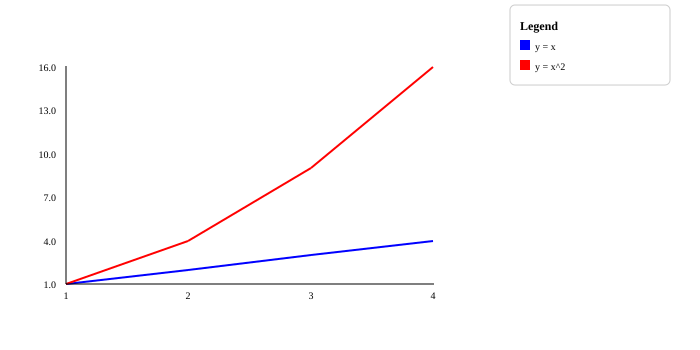

# PLOT: títulos, ejes y colores

Un gráfico sin nombres es como un mapa sin letreros: ves las formas, pero no sabes qué quieren decir. Las funciones de esta página le ponen **letreros** (título y nombres de los ejes), una **cuadrícula** para leer mejor los valores, **colores** y una **leyenda** que explica qué es cada línea.

Todas funcionan igual: **apuntan un ajuste** que se usará cuando el gráfico se dibuje. Por eso van **después** de `plot.figure()` y **antes** de `plot.render()`. Si no sabes todavía qué hacen esas dos, empieza por [Líneas y puntos](lines.md).

!!! tip "Los ejemplos se limpian solos"
    Los ejemplos terminan con `files.delete(...)` para no dejar dibujos en la carpeta de pruebas. Quita esas líneas en tu programa para quedarte con el dibujo.

## Letreros: título y ejes { #labels }

Un **eje** es cada una de las dos reglas del gráfico: el eje **x** es la horizontal (de izquierda a derecha) y el eje **y** es la vertical (de abajo hacia arriba).

### `plot.title(text)` { #title }

**Qué hace:** Pone un **título** arriba del gráfico, en el centro y en negrita.

**Cuándo usarla:** Siempre que alguien más vaya a ver tu gráfico: el título dice de qué trata.

| Parámetro | Tipo | Qué significa |
|---|---|---|
| `text` | `STR` | El título. |

**Devuelve:** `VOID` (nada).

**Ejemplo:**

```kafe
--8<-- "tests/DocsExamples/plot/title.kf"
```

**Resultado:** el archivo `title.svg`:

{ .example-chart }

### `plot.xlabel(text)` { #xlabel }

**Qué hace:** Pone un nombre **debajo del eje x** (el horizontal).

**Cuándo usarla:** Para decir qué se mide de izquierda a derecha, por ejemplo `"días"`.

| Parámetro | Tipo | Qué significa |
|---|---|---|
| `text` | `STR` | El nombre del eje x. |

**Devuelve:** `VOID` (nada).

**Ejemplo:**

```kafe
--8<-- "tests/DocsExamples/plot/xlabel.kf"
```

**Resultado:** el archivo `xlabel.svg`:

{ .example-chart }

### `plot.ylabel(text)` { #ylabel }

**Qué hace:** Pone un nombre **junto al eje y** (el vertical), girado para leerse de abajo hacia arriba.

**Cuándo usarla:** Para decir qué se mide hacia arriba, por ejemplo `"altura (cm)"`.

| Parámetro | Tipo | Qué significa |
|---|---|---|
| `text` | `STR` | El nombre del eje y. |

**Devuelve:** `VOID` (nada).

**Ejemplo:**

```kafe
--8<-- "tests/DocsExamples/plot/ylabel.kf"
```

**Resultado:** el archivo `ylabel.svg`:

{ .example-chart }

### `plot.grid(on)` { #grid }

**Qué hace:** Enciende (`True`) o apaga (`False`) una **cuadrícula**: líneas grises suaves, como las de un cuaderno de matemáticas, que te ayudan a leer los valores.

**Cuándo usarla:** Cuando quieras leer con más precisión cuánto vale cada punto.

| Parámetro | Tipo | Qué significa |
|---|---|---|
| `on` | `BOOL` | `True` para mostrarla, `False` para ocultarla (así viene al empezar). |

**Devuelve:** `VOID` (nada).

**Ejemplo:**

```kafe
--8<-- "tests/DocsExamples/plot/grid.kf"
```

**Resultado:** el archivo `grid.svg`:

{ .example-chart }

## Colores y tamaños { #colors }

Los colores se escriben con su **nombre en inglés**, entre comillas: `"red"` (rojo), `"blue"` (azul), `"green"` (verde), `"orange"` (naranja), `"purple"` (morado)… También sirven códigos como `"#ff8800"`. PLOT copia el texto tal cual dentro del archivo SVG, así que vale cualquier color que entienda un navegador.

Cada serie recuerda los colores que estaban apuntados **cuando hiciste su `graph`**. Así puedes cambiar de color entre una serie y otra.

### `plot.color(name)` { #color }

**Qué hace:** Cambia el color de la **línea** de las series que agregues después. Al empezar es `"blue"`.

**Cuándo usarla:** Para distinguir varias líneas en el mismo gráfico.

| Parámetro | Tipo | Qué significa |
|---|---|---|
| `name` | `STR` | El nombre del color en inglés o un código como `"#ff8800"`. |

**Devuelve:** `VOID` (nada).

**Ejemplo:**

```kafe
--8<-- "tests/DocsExamples/plot/color.kf"
```

**Resultado:** el archivo `color.svg`:

{ .example-chart }

### `plot.pointColor(name)` { #pointcolor }

**Qué hace:** Cambia el color de los **puntos** (los circulitos) de las series que agregues después. Al empezar es `"red"`.

**Cuándo usarla:** En gráficos de puntos, o para que los puntos combinen con su línea.

| Parámetro | Tipo | Qué significa |
|---|---|---|
| `name` | `STR` | El nombre del color en inglés o un código como `"#ff8800"`. |

**Devuelve:** `VOID` (nada).

**Ejemplo:**

```kafe
--8<-- "tests/DocsExamples/plot/point-color.kf"
```

**Resultado:** el archivo `point-color.svg`:

{ .example-chart }

### `plot.pointSize(size)` { #pointsize }

**Qué hace:** Cambia el **tamaño** de los puntos. El número es el radio del circulito, en píxeles. Al empezar es `3`.

**Cuándo usarla:** Para que los puntos se vean mejor cuando son pocos, o para achicarlos cuando son muchos.

| Parámetro | Tipo | Qué significa |
|---|---|---|
| `size` | `INT` | El radio de cada punto, en píxeles. Debe ser un entero. |

**Devuelve:** `VOID` (nada).

**Ejemplo:**

```kafe
--8<-- "tests/DocsExamples/plot/point-size.kf"
```

**Resultado:** el archivo `point-size.svg`:

{ .example-chart }

## Leyenda { #legend-group }

Cuando hay varias líneas, una **leyenda** es la cajita que dice qué significa cada color, como la que trae un mapa para explicar sus símbolos.

### `plot.legend(text)` { #legend }

**Qué hace:** Agrega una caja con el título `Legend` a la derecha del gráfico. Cada renglón de la leyenda se escribe como `color: texto`, y los renglones se separan con `;`.

**Cuándo usarla:** Siempre que dibujes dos o más series en el mismo gráfico.

| Parámetro | Tipo | Qué significa |
|---|---|---|
| `text` | `STR` | Los renglones, por ejemplo `"blue: ventas; red: gastos"`. |

**Devuelve:** `VOID` (nada).

**Ejemplo:**

```kafe
--8<-- "tests/DocsExamples/plot/legend.kf"
```

**Resultado:** el archivo `legend.svg`:

{ .example-chart }

!!! note "Ojo"
    - PLOT no revisa que los colores de la leyenda coincidan con los de las líneas: tú decides qué escribir.
    - Un renglón sin `:` aparece como texto, sin cuadrito de color.
    - En un **pastel** (`pie`) la leyenda funciona distinto: mira [`pie`](bars-pies.md#pie).

## Resumen { #summary }

| Función | Qué hace |
|---|---|
| [`plot.title(text)`](#title) | Título arriba del gráfico. |
| [`plot.xlabel(text)`](#xlabel) | Nombre del eje horizontal. |
| [`plot.ylabel(text)`](#ylabel) | Nombre del eje vertical. |
| [`plot.grid(on)`](#grid) | Enciende o apaga la cuadrícula. |
| [`plot.color(name)`](#color) | Color de las líneas siguientes. |
| [`plot.pointColor(name)`](#pointcolor) | Color de los puntos siguientes. |
| [`plot.pointSize(size)`](#pointsize) | Tamaño de los puntos siguientes. |
| [`plot.legend(text)`](#legend) | Caja que explica cada color. |

## ¿Qué aprendiste?

- Los ajustes de estilo van entre `figure()` y `render()`.
- Los colores se escriben en inglés (`"red"`) o como código (`"#ff8800"`).
- Cada serie guarda los colores que estaban puestos cuando hiciste su `graph`.

[Siguiente: barras y pasteles :material-arrow-right:](bars-pies.md){ .md-button .md-button--primary }
